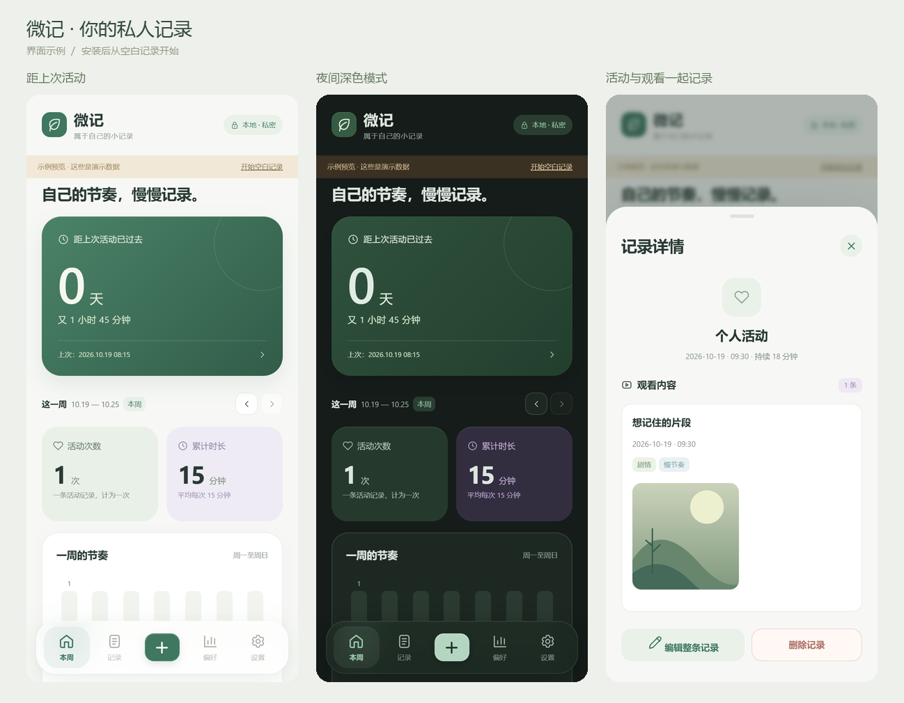

# 微记 · 个人记录

这是供个人使用的离线安卓应用。新版安装文件在 `artifacts/weiji-v1.2.1.apk`。使用与旧版相同的签名，可覆盖安装更新并保留已有数据。

[下载 Android 安装包 1.2.1](https://github.com/Quiltpromax/WeiJi/raw/refs/heads/main/artifacts/weiji-v1.2.1.apk) · [更新日志](CHANGELOG.md) · [下载源码](https://github.com/Quiltpromax/WeiJi/archive/refs/heads/main.zip)



## 1.2.1 本地同步说明

本版同步了朋友夜间版的深浅色模式、固定顶栏、居中添加按钮、页面动画和触感反馈。原包名仍为 `com.weiji.privatejournal`，使用原项目 `.tools/weiji-signing.p12` 签名，内部版本号为 8；可用于更新原版 1.2.0。朋友的夜间版使用另一个包名和签名，若要将夜间版记录转回原版，需要导出并恢复 JSON 备份。

本次从朋友 APK 中提取可读的前端 JavaScript、HTML 和主题样式；原生主题与触感接口根据安装包和更新说明补入现有 Java 源码。记录核心与基础样式核对为相同，原数据目录、密码锁和备份方式沿用。同步前源码已备份在 `build/import-1.2.1/source-before-sync.zip`，源码压缩包不包含私钥。

## 安装和开始使用

1. 把 APK 发到安卓手机，在手机的文件管理器中打开。
2. 如果系统要求，允许当前文件管理器安装应用，然后完成安装。
3. 打开「微记」，点底部中央 ＋ 记录活动，并按需补充观看内容。

支持 Android 8.0 及以上。预览图使用演示数据；实际安装后为空白，不会自动写入演示记录。

## 功能

- 活动：日期、开始时间、持续分钟、备注；手动补录或开始/结束计时。
- 首页重点显示距上次活动多少天，并显示剩余小时和分钟。从最近活动的开始时间计算，每满 24 小时算一天；编辑或删除活动后会重新计算。
- 本周：周一至周日的次数、累计/平均时长、每日活动分布，可切换往周。
- 观看为活动内的选填内容，可添加一条或多条：观看日期/时间、名称、备注、每条最多 12 张截图及自定义标签。
- 标签：自由创建、改名、换色、删除；一条观看记录可选多个标签。
- 偏好：今天、本周、本月、全部、自选日期；标签次数/占比排行与趋势，点击排行查看记录。
- 历史：每次活动与其中的观看内容显示为一条记录，筛选全部/含观看/仅活动；搜索、一起编辑、删除、放大截图。
- 外观：跟随系统、浅色、深色，记住选择；固定顶栏、底部导航、页面动画和原生触感反馈。
- 隐私：本机存储、可选 4–8 位密码锁，离开应用后再次打开需要解锁。
- 备份：导出和恢复 JSON，包含标签、活动、观看及截图；恢复前明确确认替换数据。

活动日期、开始时间和持续时长必填；观看内容选填。保存后在详情里选择「编辑整条记录」，可同时修改活动和观看信息，也可后补或移除观看内容。整条删除会同时删除其观看内容；编辑中只移除观看内容会保留活动。每条活动计一次。标签次数以观看记录数计算，同一标签在同一记录里只计一次。占比分母包含未打标签的观看记录，多标签占比之和可能超过 100%。图片数量不影响次数。

截图复制到应用的私有目录，保留方向并缩放到最长边 1600 像素后保存为 JPEG。应用没有联网、相册读取或外部存储的广泛权限，图片与备份通过系统文件选择器操作。

## 备份是什么，怎么恢复

在设置里点「导出备份」，选择保存位置，会得到一个名称类似 `微记-备份-2026-10-13.json` 的文件。文件包含全部活动记录、观看记录、标签、备注和截图；截图已经包含在文件内，不需要另外传图片。密码锁设置不包含在备份里。

恢复时，在同一手机或安装了微记的新手机上，打开「设置 → 恢复备份 → 确认」，选择之前导出的 `.json` 文件。应用验证文件后恢复记录、标签和截图，重新生成统计。恢复会替换当前数据，不进行合并。旧版微记导出的备份也可以恢复；原有的有效活动绑定会保留，没有绑定或绑定已失效的旧观看记录显示为「待补全活动」，内容和截图保留，并继续计入观看统计。可以在编辑时选择归入已有活动或新建活动；不会自动猜测归属或补造活动时长。视频链接不再恢复。

密码锁限制打开应用，不是整个数据库的加密功能。安卓版本使用随机盐和 PBKDF2 保存密码校验值；启用后隐藏系统最近任务中的内容。备份是普通文件，不带密码，请保存在自己的位置。卸载应用会清除本机记录，卸载或换手机前请先导出备份。单个备份最大 80 MB。

## 预览

`artifacts/preview-overview.png` 是界面预览。

`artifacts/weiji-preview.html` 是可直接用浏览器打开的独立交互预览，包含界面、图表和示例图片，不依赖本地预览服务。点击「开始空白记录」可以试用记录功能。

在电脑运行以下命令，再访问 `http://127.0.0.1:8765/?demo=1`，可以交互查看示例界面。去掉 `?demo=1` 则是空白模式。浏览器预览数据保存在本浏览器，与安卓数据分开。

```powershell
python tools/preview_server.py
```

## 本地重新构建

需要 Python 3.10+、Node.js 18+ 和联网下载一次构建工具。工具只下载到项目 `.tools`，不修改电脑全局配置。

```powershell
npm.cmd ci
python tools/setup_android.py
python tools/build_apk.py
```

构建使用官方 Android Build Tools、Android 35 平台和 Azul JDK 17；通过 javac/D8/aapt2/zipalign/apksigner 生成安装包。JavaScript 在打包时适配 Chrome 61 语法。`app/` 也是标准 Android 源码目录，可使用 Android Studio 查看。

首次构建在 `.tools/weiji-signing.p12` 创建本机签名密钥，密码保存在 `.tools/signing-password.txt`。请保留这两个文件，后续使用相同密钥签名才能覆盖更新并保留手机数据。源码 ZIP 不包含私人签名密钥或工具包。

GitHub 仓库同样不包含签名私钥、密码、个人记录或电脑上的开发工具缓存。其他开发者首次构建会生成自己的签名，因此自行构建的安装包不能直接覆盖这里提供的原签名安装包。

## 检查

```powershell
npm.cmd test
npm.cmd run test:ui
```

统计/备份格式测试和浏览器操作检查涵盖：跨周日期、多标签统计、未标记记录占比、图片与计数分离、保存和重载、改名和删除、图片备份恢复、密码锁、计时、窄屏布局以及安卓适配接口。APK 的签名和 ZIP 对齐已校验。本次构建没有连接实体安卓手机，文件选择器、安卓生命周期和设备兼容性仍需在手机上实际验证。

所有运行时界面文件均随 APK 打包，无运行时第三方网络服务。
